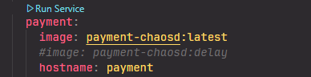
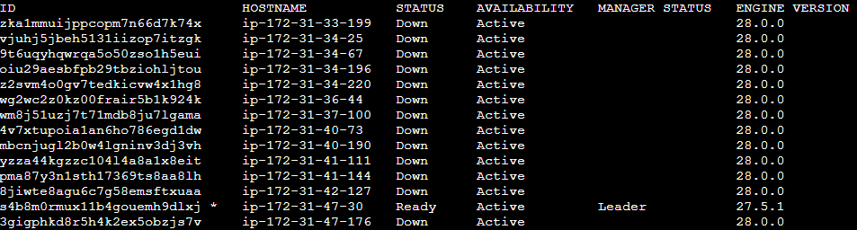

# Sockshop Microservices

## Prerequisites
- Clone the project to your machine. Supposing the absolute path of the cloned repository is `<PROJECT_DIR>`.
- For microservice deployment, it is required to install `docker` (version >= 27.4.0). If you have not installed docker, you can install it by running the command:
```bash
sh <PROJECT_DIR>/install.sh
```

## Build
For each `<PROJECT_DIR>/node<ID>` folders, build the docker image for the service with corresponding investigating toolkit (e.g. datadog, dynatrace). 

**NOTE**: Adjust the image name of the service in `<PROJECT_DIR>/node1/docker-compose.yml` with respect to the service/test that you are investigating.



## Deployment

### Default deployment - Single-node deployment
For default deployment of the microservice on **single node** for testing purpose, please refer to the `<PROJECT_DIR>/docker-compose.yml`.
```bash
cd <PROJECT_DIR>
docker compose up -d
```

### Microservice deployment with Docker Swarm - Distributed Deployment

The microservice requires 14 machines/VMs/nodes for deployment. Please make sure that these ports are opened for all of the machines:

* Port `2377` TCP for communication with and between manager nodes
* Port `7946` TCP/UDP for overlay network node discovery
* Port `4789` UDP (configurable) for overlay network traffic

**NOTE**: Please ensure that all the machines/VMs/nodes are in the same **internal network** so that they could talk to each other.

---

1. Choose one machine acting as the swarm manager. Initialize `docker swarm` on that swarm manager machine:
```bash
docker swarm init --advertise-addr <MANAGER-IP>
```
After running, it generates a `<TOKEN>` for other node to join the swarm

2. On other machines/VMs/nodes, join the swarm:
```bash
docker swarm join --token <TOKEN> <MANAGER-IP>:2377
```

3. Refer to the `<PROJECT_DIR>/node1/docker-compose.yml`, on the manager machine, add label for the nodes for suitable service deployment. Firstly, view the node id with corresponding IP address:
```bash
docker node ls
```


- Add label for the node using the command:
```bash
docker node update --label-add node=node-<ID> <NODE-ID>
```
- For instance, add label for `node-1` to run `rabbitmq` service: 
```bash
docker node update --label-add node=node-1 s4b8m0rmux11b4gouemh9dlxj
```

4. After adding labels, deploy the microservice by running:
```bash
sh <PROJECT_DIR>/node1/start.sh
```
To stop the microservice, run `sh <PROJECT_DIR>/node1/stop.sh`.